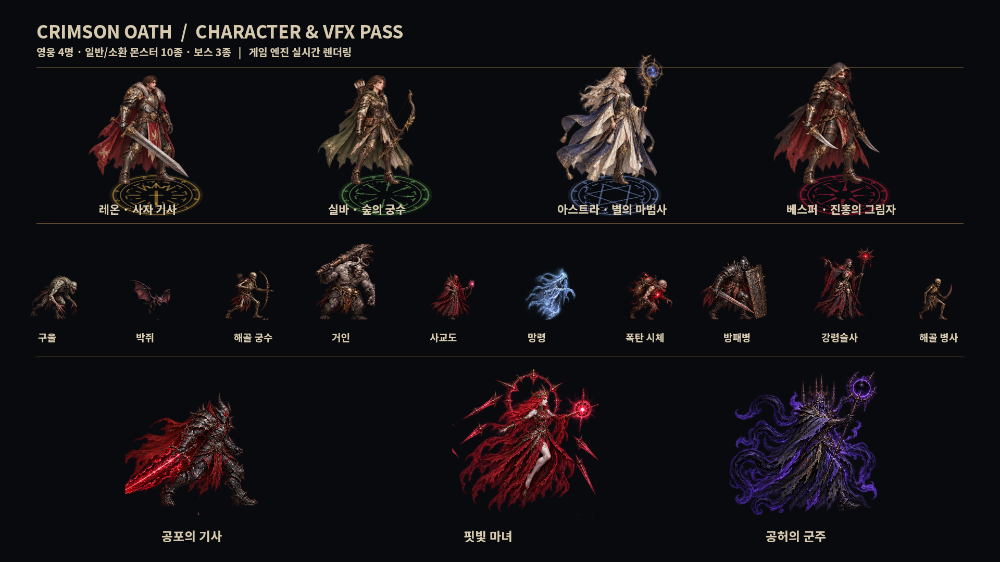
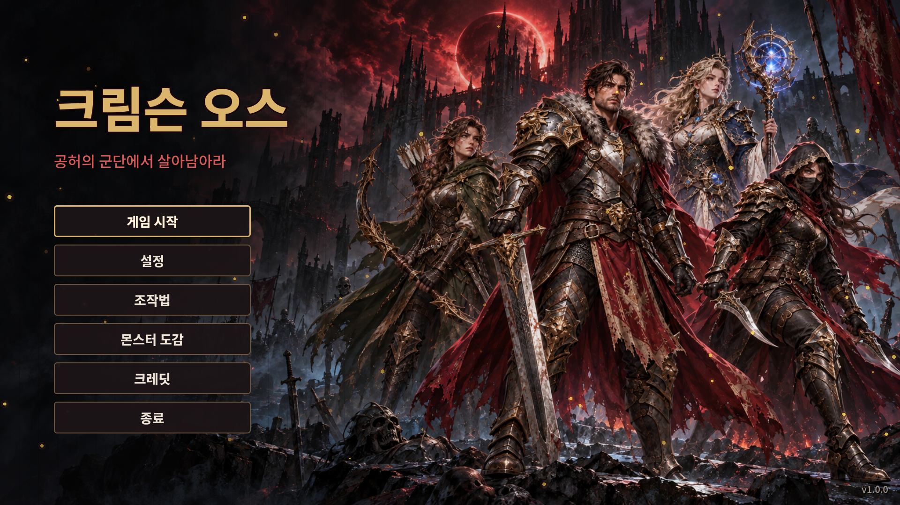

# 캐릭터·몬스터·스킬 효과 적용

사용자가 제공한 크림슨 오스 원화를 기준으로 제작한 게임용 스프라이트 1차 패스입니다.
제작 도구는 내장 `image_gen.imagegen`이며, 원본 시트 7장과 전체 생성 프롬프트는
[`tools/art_sources/`](../tools/art_sources/)에 있습니다.



## 적용 범위

| 구분 | 적용 | 동작 / 크기 |
|---|---|---|
| 영웅 4명 | 레온, 실바, 아스트라, 베스퍼 | 대기·달리기·기본 공격 각 4프레임, 384px 정사각형 |
| 일반 몬스터 10종 | 구울부터 해골 병사까지 전체 | 이동/비행 4프레임, 192px 또는 256px |
| 정예 | 기존 금색 문양과 1.3배 크기 유지 | 일반 몬스터 그림 공유 |
| 보스 3종 | 공포의 기사, 핏빛 마녀, 공허의 군주 | 4프레임 루프, 512px / 640px |

게임은 기존 `SpriteSet` 경로를 그대로 사용합니다. 모든 PNG는 투명 RGBA이며,
발 위치는 프레임 중앙·아래에서 1/16 높이에 정렬했습니다. 긴 무기와 망토 때문에
영웅·보스 프레임은 기존 가이드의 권장값보다 크게 잡았습니다.

## 시작 화면



`assets/menu/title-screen.png`에 새 4인 영웅·고딕 성채 키아트를 적용했습니다.
제목과 버튼은 이미지에 구워 넣지 않고 기존 한국어/영어 UI로 유지합니다.
배경은 비율을 유지해 화면을 채우고, 왼쪽 버튼 영역에 어두운 그라데이션을 덧씌웁니다.
영웅 선택 화면도 같은 배경을 어둡게 공유합니다. 기존 불씨 애니메이션은 유지합니다.

## 스킬 효과

- 기사: 황금 왕관·검 문양, 충격파와 검기, 캐릭터 형태의 돌진 잔상.
- 궁수: 녹색 잎 문양, 관통 화살의 녹색 궤적, 속박 덫과 화살비 범위의 문양.
- 마법사: 별자리 봉인과 회전 궤도, 별빛 투사체 궤적, 중력장·유성 낙하 지점 문양.
- 도적: 진홍색 단검 문양, 투척 단검 궤적, 실제 캐릭터 프레임을 사용하는 순간이동 잔상.
- 피격 시 새 영웅 그림에 흰색 반짝임이 적용됩니다. 은신 투명도와 무적 깜빡임은 곱해집니다.

추가 효과는 코드로 그린 시각 효과입니다. 피해량·쿨다운·충돌·적 공격 예고는 기존 로직을 사용합니다.

## 현재 동작 범위

완성 원화와 같은 재질·색·실루엣을 작은 게임 화면에 맞춘 4프레임 애니메이션입니다.
영웅 스킬은 기본 공격 동작, 대시는 달리기를 공유합니다. 보스 대기·이동은 같은 루프를
공유하고, 전용 시전·사망 그림은 아직 없습니다. 몬스터 전용 공격 그림도 이동 루프를
대체 동작으로 사용합니다. AI 시트 특성상 빠른 동작에서 무기/망토 형태가 조금 달라지며,
8방향 수작업 애니메이션 수준의 연속성은 아닙니다.

## 다시 만들기·검증

```bash
python tools/pack_generated_sprites.py  # Pillow, numpy 필요
godot --headless --editor --import --quit
godot --headless --fixed-fps 60 res://tests/ui_flow.tscn
godot --headless --fixed-fps 60 res://tests/art_smoke.tscn
godot --headless --fixed-fps 60 res://tests/autoplay.tscn -- all 2
godot --fixed-fps 60 --resolution 1920x1080 res://tests/art_gallery.tscn -- /absolute/art-gallery.png
```

Godot 4.3에서 PNG 임포트, 메뉴 흐름, 네 영웅 각 2분 자동 전투,
12개 스킬·10종 몬스터·정예·3종 보스 연결을 확인했습니다.
Xvfb + Mesa llvmpipe로 실제 OpenGL 렌더링과 갤러리·전투 화면도 확인했습니다.
원본 커밋 `9473db8`에서도 메뉴 테스트 종료 시 ObjectDB/리소스 종료 경고가 재현됩니다.
이번 작업에서 종료 경고 전체를 해결한 것은 아닙니다. 전체 15웨이브 완주·실기기 성능은 별도 검증 대상입니다.
