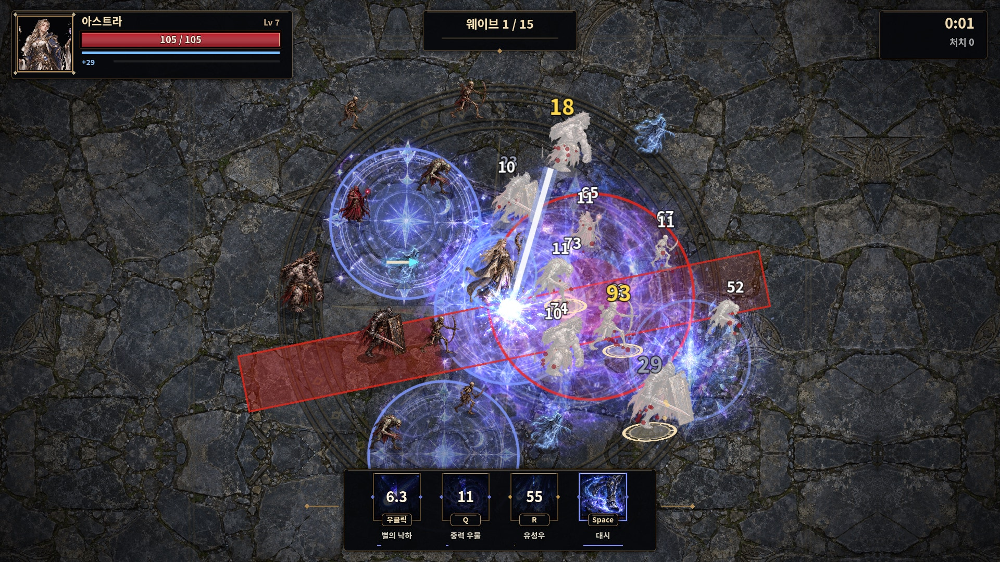
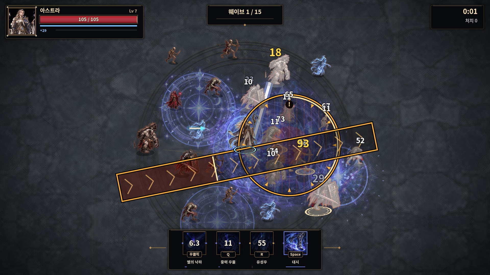

# 전투 가독성 개선

해골 궁수의 화살을 크게 만들고 빛을 더한 최신 커밋 `a9a405c`를 기준으로 작업했습니다. 해당 화살 그림·속도·명중 반경을 유지하면서 적 투사체의 표시 순서를 높였습니다.

## 실제 화면 비교

같은 시드, 같은 몬스터 배치에서 마법사의 스킬 3개와 원형·직선 위험 예고를 겹쳤습니다. 모두 Godot 4.3의 실제 렌더링 캡처입니다. 비교를 위해 적의 체력과 이동, 플레이어 무적을 조정한 테스트 장면입니다.

### 이전



### 이후



## 적용한 조정

| 대상 | 조정 |
|---|---|
| 바닥 | 석재 텍스처의 잔무늬·채도·명암 차이를 셰이더로 억제. 중앙 문양과 청동 인레이 투명도를 낮춤. 원본 텍스처는 유지 |
| 플레이어 | 옅은 청백색 윤곽선과 어두운 바탕의 발밑 링, 약한 밝기 보정. 피격·은신·무적 투명도 유지. 발밑 링은 별도로 그려 은신 중에도 자기 위치를 확인 |
| 몬스터 | 따뜻한 색의 얇은 윤곽선. 정예·보스는 조금 더 강하게 표시. 기존 피격 반짝임과 망령 투명도 유지 |
| 스킬 | 그림 효과의 전체 발광과 긴 문양·중력장·연막의 강도를 낮춤. 캐릭터를 장식 효과 위에 그림 |
| 적 공격 예고 | 어두운 경계와 호박색 선, 원형 내부 무늬·경고 기호·안쪽 삼각형, 직선 방향 화살표·발동 진행 표시. 아군 마법진과 형태로도 구분 |
| 적 투사체 | 최근 수정된 큰 청록색 해골 화살을 포함한 적 투사체가 아군 효과 위에서 보이도록 표시 순서 조정 |

[전사와 군중 속 플레이어](previews/readability/knight-crowd.jpg) · [궁수 스킬과 위험 예고](previews/readability/ranger-overlap.jpg) · [도적 스킬과 위험 예고](previews/readability/rogue-overlap.jpg)

## 표시 순서

바닥(-10) → 아군 지면 효과(-5) → 아군 낙하 예고(-4) → 아군 투사체·장식 효과(20) → 캐릭터(22/23) → 적 공격 예고(35) → 플레이어 발밑 위치 링(36) → 적 투사체(40). 적 경고선은 스킬을 겹쳐 써도 경계를 확인할 수 있으며, 피해 숫자와 HUD는 별도 상위 레이어를 유지합니다.

표시만 바꿨습니다. 피해량, 공격 반경과 직선 폭·길이, 공격 지연 시간, 쿨다운, 이동, 충돌 로직은 유지합니다. 마법사의 유성 착탄 예고는 `hostile = false`로 구분해 적 경고 모양이 적용되지 않도록 했습니다. 자동 전투 봇도 아군 예고는 회피 대상으로 취급하지 않습니다.

## 검증

```bash
godot --headless --editor --import --quit
godot --headless --fixed-fps 60 res://tests/art_smoke.tscn
godot --headless --fixed-fps 60 res://tests/autoplay.tscn -- all 2
godot --fixed-fps 60 --resolution 1920x1080 res://tests/readability_preview.tscn -- /absolute/output verify
```

- Godot 4.3 임포트 및 실제 OpenGL 셰이더 컴파일·렌더링 확인.
- 네 영웅·스킬 12개·몬스터 10종·정예·보스 3종 연결 검사 통과.
- 네 영웅의 군중 및 스킬 겹침 화면 8장 생성. 적 예고/투사체의 표시 순서, 원형 반경·직선 폭·길이 유지, 예고 종료 콜백이 정확히 한 번 발동하는 것 확인.
- 네 영웅 각각 2분 자동 전투 회귀 검사. 전체 15웨이브 완주와 실기기 성능은 이 검사의 범위가 아닙니다. 기존 종료 시 ObjectDB/리소스 정리 경고는 남을 수 있습니다.
