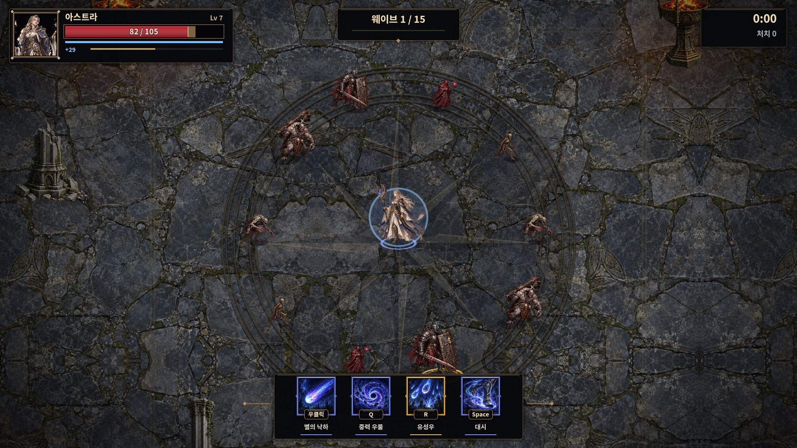
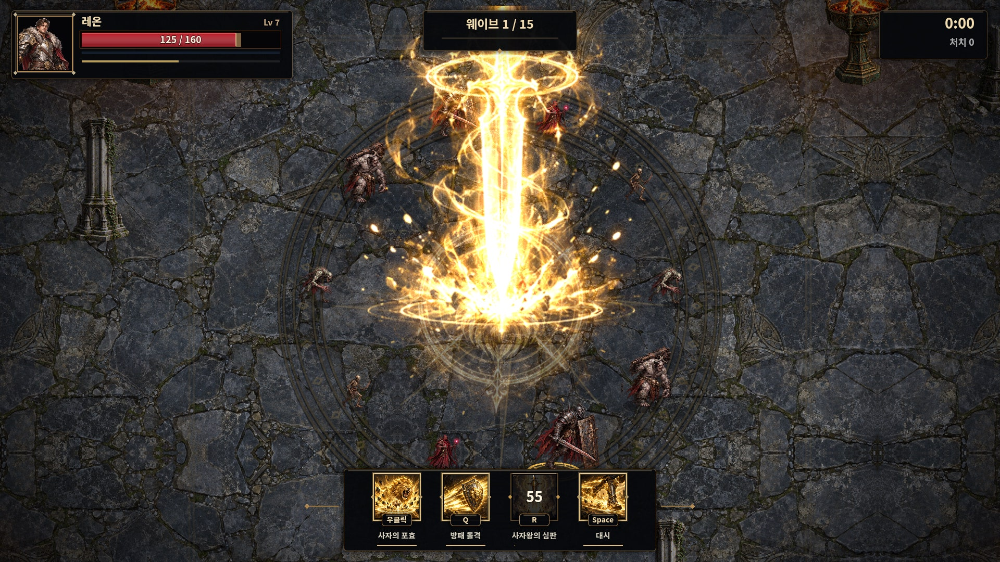
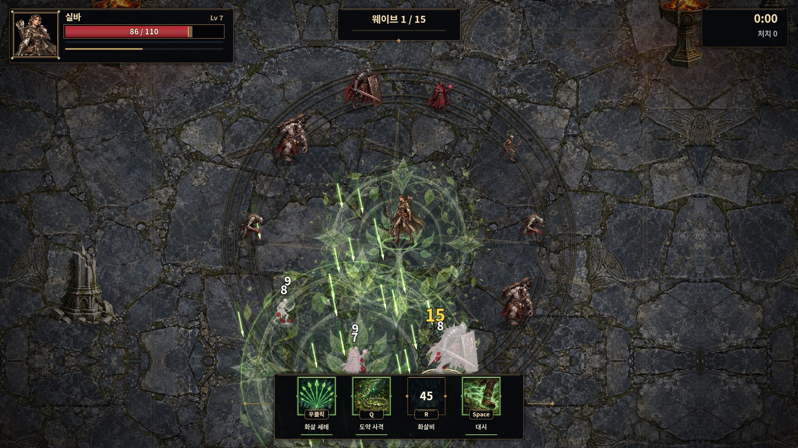
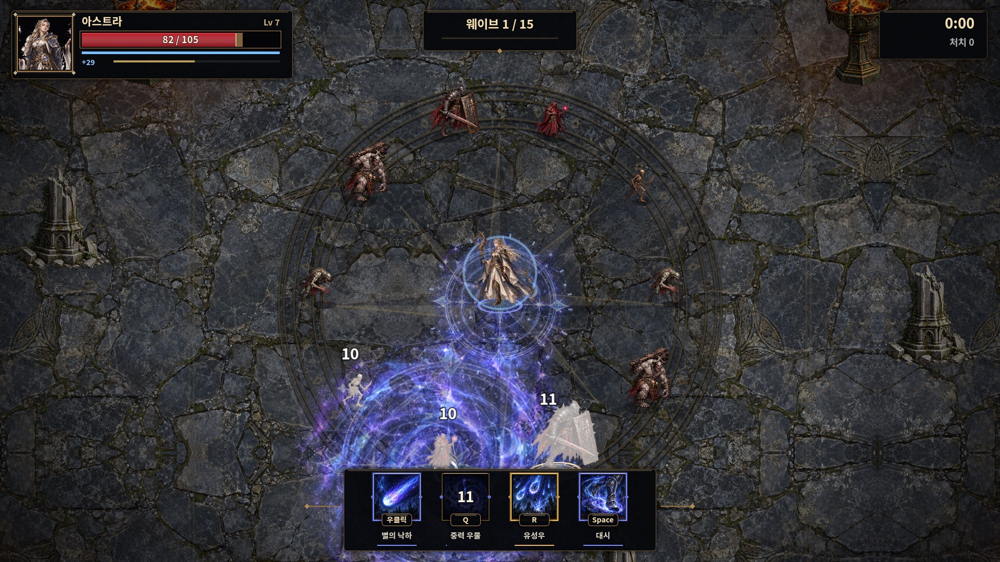
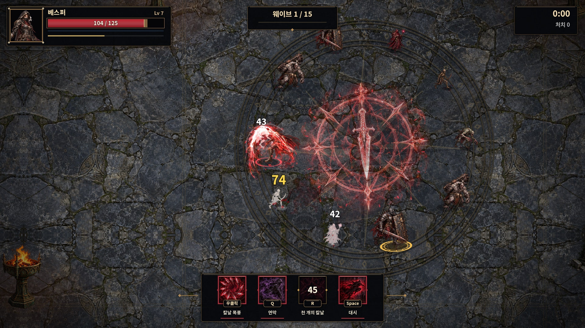

# 전투 화면 품질 개선

기존 단색 격자 바닥과 원형 단축키 표시를 석재 안뜰과 직업별 스킬 아이콘으로 교체했습니다. PR #1의 캐릭터·몬스터 그림 위에 새 그림 효과를 연결한 후속 아트 패스입니다.



## 적용 내용

| 구분 | 적용 |
|---|---|
| 맵 | 풍화된 석재·균열·이끼, 중앙의 돌 장미 문양, 청동 인레이, 조각 기둥·부서진 기둥·석상·화로, 불씨·먼지 |
| 체력바 | 초상화와 금속 프레임, 붉은 그라데이션 체력, 지연되는 피해 표시, 별도의 푸른 보호막과 경험치, 저체력 강조 |
| 스킬 슬롯 | 직업별 그림 16개, 금속 테두리, 작은 키캡, 스킬명, 원형 쿨다운 차폐, 남은 초·충전 막대·준비 발광 |
| 스킬 효과 | 그림으로 제작한 문양·검기·충격·검 낙하·중력 소용돌이·진홍 연막, 별빛 구체 발광과 강화된 투사체 궤적 |
| UI 대응 | 한국어/영어, 기존 키보드/패드 표시, 창 크기에 따른 비율 조정, 긴 영문 스킬명 자동 글자 크기 조정 |

기존 `우클릭 / Q / R / Space` 조작은 유지하고 아이콘 아래의 작은 키캡으로 옮겼습니다. 피해량·쿨다운·적 공격 예고·기존 벽과 기둥의 충돌 반경은 변경하지 않았습니다. 추가 화로와 먼지는 장식입니다.

## 실제 스킬 사용 장면

아래는 Godot의 실제 월드와 스킬 함수를 실행해 얻은 캡처입니다. 검증용으로 레벨 7, 적의 체력·위치를 고정하고 무적을 부여했으며, 궁극기 대기 시간을 해제했습니다. 합성 전투 화면이 아닙니다.

| 직업 | 우클릭 | Q | R |
|---|---|---|---|
| 레온 | [사자의 포효](previews/combat-v2/knight_skill.jpg) | [방패 돌격](previews/combat-v2/knight_skill2.jpg) | [사자왕의 심판](previews/combat-v2/knight_ult.jpg) |
| 실바 | [화살 세례](previews/combat-v2/ranger_skill.jpg) | [도약 사격](previews/combat-v2/ranger_skill2.jpg) | [화살비](previews/combat-v2/ranger_ult.jpg) |
| 아스트라 | [별의 낙하](previews/combat-v2/mage_skill.jpg) | [중력 우물](previews/combat-v2/mage_skill2.jpg) | [유성우](previews/combat-v2/mage_ult.jpg) |
| 베스퍼 | [칼날 폭풍](previews/combat-v2/rogue_skill.jpg) | [연막](previews/combat-v2/rogue_skill2.jpg) | [천 개의 칼날](previews/combat-v2/rogue_ult.jpg) |

### 레온 — 사자왕의 심판



### 실바 — 화살비



### 아스트라 — 중력 우물



### 베스퍼 — 천 개의 칼날



## 체력·쿨다운·언어·창 크기

- [저체력·보호막·보스 체력·스킬 대기 시간](previews/combat-v2/boss_low_hp.jpg)
- [영어 UI](previews/combat-v2/english_hud.jpg)
- [1280×720 창에서의 UI](previews/combat-v2/hud_window_1280x720.jpg) — Godot의 캔버스 확대/축소를 사용하므로 캡처 텍스처 해상도는 창 해상도와 다를 수 있습니다.

## 리소스와 구현

원본 생성 PNG는 `assets/environment/`, `assets/ui/`, `assets/vfx/`에 있습니다. 내장 imagegen으로 생성했으며 [전체 프롬프트와 아틀라스 규격](../tools/art_sources/combat-polish-prompts.md)을 함께 보관했습니다.

`combat_art.gd`가 아틀라스 영역과 가산 합성 재질을 공유합니다. 이미지의 검은 배경은 가산 합성으로 사라지고, 반투명 문양 아래의 적과 바닥이 보입니다. 프레임마다 파일을 읽거나 그림을 새로 만들지 않습니다. 바닥은 정적 캔버스 명령이며 양 옆 타일을 반전해 경계 픽셀을 맞췄습니다. UI 패널 스타일도 캐시합니다.

## 재현과 검증

```bash
godot --headless --editor --import --quit
godot --headless --fixed-fps 60 res://tests/ui_flow.tscn
godot --headless --fixed-fps 60 res://tests/art_smoke.tscn
godot --headless --fixed-fps 60 res://tests/autoplay.tscn -- all 2
godot --fixed-fps 60 --resolution 1920x1080 res://tests/combat_polish.tscn -- /absolute/output
```

Godot 4.3에서 임포트, 메뉴 흐름, 네 영웅·스킬 12개·몬스터 10종·정예·보스 3종을 확인했습니다. Xvfb/Mesa llvmpipe의 실제 OpenGL 렌더링으로 스킬별 PNG/JPEG, 각 직업 HUD, 보스/저체력/보호막/영어 UI, 1280×720 창을 확인했습니다. 자동 전투는 네 영웅 각각 2분으로 제한한 회귀 검사이며, 전체 15웨이브 완주나 실기기 성능 인증은 아닙니다. 메뉴 경로 테스트 종료 시 원본에도 있던 ObjectDB/리소스 정리 경고가 남을 수 있습니다.
