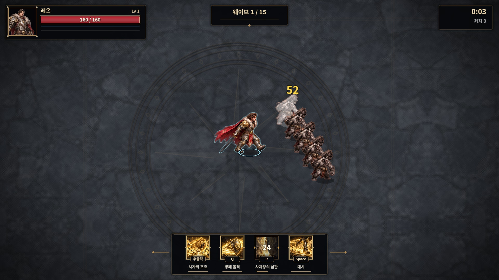

# 기사 레온: 3D 포즈 제작과 게임용 스프라이트 적용

기준 커밋은 `5b68d52`입니다. 최신 걷기 보정·일반 몬스터 경고 정리·처치 수 수정·Blender 데모를 확인한 뒤 기사 레온을 작업했습니다.

## 게임에 적용되는 결과

| 동작 | 기본 적용 | 비교용 대안 |
|---|---|---|
| 대기 | 4프레임 | 같은 4프레임 |
| 이동 | 10프레임, 한 주기 0.65초 | 8프레임 |
| 기본 공격 | 10프레임, 기존 공격 시간에 맞춰 재생 | 8프레임 |

기본 그림은 `assets/sprites/heroes/knight/`에 연결했습니다. 8프레임 대안은 `assets/sprites/variants/knight_8/`에 있습니다. 프레임은 512px 정사각형, 투명 PNG 가로 스트립입니다. 몸의 기준 높이는 약 250px이며, 검을 들었을 때 몸 전체가 작아지는 현상을 줄이도록 무기와 몸의 정렬 기준을 나눴습니다.

머리 위로 검을 드는 자세는 별도 아틀라스에서 가져옵니다. 칼끝과 앞줄의 발이 겹치지 않도록 두 자세를 분리 제작했고, 머리부터 발바닥까지의 길이를 별도 기록해 무기 높이 때문에 몸이 축소되는 문제를 방지했습니다.

기사에게는 기존 4프레임 그림용 다리 UV 압축·추가 들썩임을 적용하지 않습니다. 원래 그림으로 움직이는 다른 직업의 보정은 기존 경로를 사용합니다. 새 이동 한 주기에 발소리와 먼지는 두 번 발생합니다. 기본 공격·스킬의 피해와 판정은 기존 게임 코드가 담당합니다.

## 실제 제작 과정과 구분

1. 기존 레온과 승인된 외형 시안의 은색·금색 갑옷, 사자 어깨 장식, 털 칼라, 붉은 망토와 대검을 디자인 기준으로 삼았습니다.
2. Blender에서 실제 메시와 계층형 관절 피벗을 갖는 **모션용 베이스 모델**을 만들었습니다. 대기·이동·공격 세 클립이 있는 GLB를 내보냈습니다. 이동은 두 관절 다리 IK로 접지와 발 회수를 나눴습니다.
3. 실제 Blender 렌더를 포즈 가이드로 사용하고, 이미지 생성 도구로 갑옷·얼굴·망토의 최종 그림을 보정했습니다. 프롬프트와 보정 전후 아틀라스를 함께 보관합니다.
4. 완성 그림을 정렬·패킹해 Godot의 기존 스프라이트 로더에 연결했습니다.

**GLB는 단순화한 모션 제작용 모델입니다. 최종 스프라이트의 세밀한 장식은 이미지 보정으로 완성됐으며, GLB에 동일한 고해상도 조형·텍스처가 들어 있는 것은 아닙니다.** 최종 게임 그림은 원본 3D 렌더와 구분해야 합니다. 게임은 선택한 방식대로 2D 전투 화면에서 스프라이트를 재생합니다.

- 승인된 외형 시안: [approved-look.png](../tools/art_sources/knight-3d/approved-look.png)
- 3D 모델: [leon.glb](../assets/models/leon/leon.glb)
- 모델·클립·렌더 생성: [knight_production.py](../tools/blender/knight_production.py)
- 보정 전 실제 렌더: [8프레임](../tools/art_sources/knight-3d/blender-guide-8.png), [10프레임](../tools/art_sources/knight-3d/blender-guide-10.png)
- 보정 후 그림: [8프레임](../tools/art_sources/knight-3d/finished-8.png), [10프레임](../tools/art_sources/knight-3d/finished-10.png), [대기](../tools/art_sources/knight-3d/finished-idle.png)
- 검을 들어 올리는 별도 자세: [finished-overhead.png](../tools/art_sources/knight-3d/finished-overhead.png)
- 재패킹: `python3 tools/pack_knight_3d.py` (Pillow, numpy, scipy)

Blender 재생성 예:

```bash
blender -b --python tools/blender/knight_production.py -- /absolute/output
```

이 명령은 모션 베이스와 보정 전 렌더를 만듭니다. 최종 이미지 보정은 별도 단계이므로 이 명령만으로 최종 그림이 재생성되지는 않습니다.

## 실행 확인

```bash
godot --headless --editor --import --quit
godot --headless --fixed-fps 60 res://tests/knight_3d.tscn
godot --headless --fixed-fps 60 res://tests/art_smoke.tscn
godot --fixed-fps 60 res://tests/knight_3d.tscn -- /absolute/capture/output
```

`knight_3d`는 GLB의 세 애니메이션과 실제 허벅지 관절 변화를 검사하고, 게임에서 4/10/10 프레임 연결, 0.65초 이동 주기, 한 주기당 두 발소리, 다리 압축 중복 방지, 좌우 반전·공격·스킬 재생을 확인합니다. `art_smoke`는 네 영웅과 스킬 12개, 몬스터·정예·보스 연결을 검사합니다. 종료 시 기존 ObjectDB/리소스 정리 경고는 남을 수 있습니다.

## 실제 게임 화면



[실제 Godot 실행 영상](previews/knight-3d/gameplay.mp4) · [동작 확대 영상](previews/knight-3d/motion-closeup.mp4)
